# Rush Hour Parking System - Class Diagram

Terminology follows the use case model: **Facility Operator** (employee at a facility), **Facility Manager** (manages one or more facilities), **System Administrator** (superuser). "Facility" in the requirements maps to `ParkingLot` in the model.

Design principles:

- A spot's physical state (`SpotStatus`), a hold's lifecycle (`HoldStatus`), a reservation's lifecycle (`ReservationStatus`), a ticket's validity (`Ticket.isValid`), and a parking visit's lifecycle (`SessionStatus`) are separate.
- PENDING and RESERVED are not stored on the spot. They are derived per time interval from `SpotHold` and `Reservation` (`ParkingSpot.getAvailabilityStatus(start, end)` returns `AvailabilityStatus`).
- Employee roles are composed of permissions: `Employee` has one `Role`, and a `Role` grants a set of `Permission`s. There are no employee subclasses.
- Money uses `BigDecimal` (never `double`). `ReservationService` and `CheckInService` are application services that coordinate atomic state changes and hold no stored data.

## 1. Customer side (UC-01 to UC-10)

```mermaid
classDiagram
direction TB

class Customer {
  <<abstract>>
  #customerId : String
  +viewParkingSpots(lot : ParkingLot) List~ParkingSpot~
  +searchParkingSpots(lot : ParkingLot, criteria : String) List~ParkingSpot~
  +holdSpot(spot : ParkingSpot, start : DateTime, end : DateTime) SpotHold
  +reserveSpot(hold : SpotHold, licensePlate : String, paymentMethod : String, idempotencyKey : String) Ticket
  +modifyReservation(ticket : Ticket, start : DateTime, end : DateTime, idempotencyKey : String) void
  +cancelReservation(ticket : Ticket) Refund
  +checkIn(ticket : Ticket, spot : ParkingSpot, method : EntryMethod) ParkingSession
  +purchaseTraditionalTicket(hold : SpotHold, licensePlate : String, paymentMethod : String, idempotencyKey : String) Ticket
}

class GuestCustomer {
  -email : String [0..1]
  -phone : String [0..1]
  +register(firstName : String, lastName : String, email : String, password : String) RegisteredCustomer
}

class RegisteredCustomer {
  -firstName : String
  -lastName : String
  -email : String
  -phone : String
  -passwordHash : String
  +login(email : String, password : String, deviceId : String) boolean
  +logout() void
  +isLocked(deviceId : String) boolean
  +requestPasswordReset(deviceId : String) boolean
  +getFullName() String
  +addVehicle(vehicle : Vehicle) VehicleLink
  +removeVehicle(vehicleId : String) void
  +confirmVehicleShare(link : VehicleLink) void
  +disputeVehicle(link : VehicleLink) void
  +viewNotifications() List~Notification~
  +setNotificationPreference(channel : NotificationChannel, optedIn : boolean, frequency : String) NotificationPreference
}

%% lockout is tracked per device; consecutive lockouts escalate 1, 5, 10, 30, 60 minutes
class DeviceLoginState {
  -deviceId : String
  -failedLoginAttempts : int
  -consecutiveLockouts : int
  -lockedUntil : DateTime [0..1]
  -lastFailureAt : DateTime
  +recordFailure() void
  +recordSuccess() void
  +isLocked(now : DateTime) boolean
  +currentLockoutMinutes() int
}

class UserSession {
  -sessionId : String
  -token : String
  -startedAt : DateTime
  -lastActivityAt : DateTime
  -status : UserSessionStatus
  +touch() void
  +isIdleWarningDue() boolean
  +isExpired() boolean
  +terminate() void
}

class Vehicle {
  -licensePlate : String
  -make : String
  -model : String
}

class VehicleLink {
  -linkId : String
  -status : OwnershipStatus
  -addedAt : DateTime
  +confirm() void
  +dispute() void
}

class Notification {
  -notificationId : String
  -type : NotificationType
  -channel : NotificationChannel
  -message : String
  -sentAt : DateTime
  -isRead : boolean
  -deliveryStatus : DeliveryStatus
  -deliveryAttempts : int
  +markRead() void
}

class NotificationPreference {
  -channel : NotificationChannel
  -optedIn : boolean
  -frequency : String
  -reminderLeadMinutes : int
}

%% a hold never resets on payment failure; timers keep running from the original claim
class SpotHold {
  -holdId : String
  -purpose : HoldPurpose
  -startTime : DateTime
  -endTime : DateTime
  -createdAt : DateTime
  -lastProgressAt : DateTime
  -warningCount : int
  -continuousInactiveSeconds : int
  -cumulativeInactiveSeconds : int
  -status : HoldStatus
  +recordProgress() void
  +issueWarning() void
  +shouldRelease() boolean
  +canRetryPayment() boolean
  +release() void
  +expire() void
  +convert() void
}

%% isValid = currently eligible for use; derived from reservation status and ticket lifecycle, not set by check-out
class Ticket {
  -ticketId : String
  -qrCode : String
  -type : TicketType
  -licensePlate : String
  -issuedAt : DateTime
  -validUntil : DateTime
  -isValid : boolean
  +validateAtGate() boolean
  +isEligibleForReentry(now : DateTime) boolean
}

%% rule: the same license plate cannot hold two reservations that overlap in time
class Reservation {
  -reservationId : String
  -startTime : DateTime
  -endTime : DateTime
  -noShowDeadline : DateTime
  -overstayGraceUsed : boolean
  -status : ReservationStatus
  +modify(start : DateTime, end : DateTime) void
  +calculatePriceDifference(start : DateTime, end : DateTime) BigDecimal
  +cancel(now : DateTime) Refund
  +isLateCancellation(now : DateTime, rule : FacilityRule) boolean
  +calculateCost() BigDecimal
  +overlaps(start : DateTime, end : DateTime) boolean
  +calculateNoShowDeadline(rule : FacilityRule) DateTime
  +isNoShowDue(now : DateTime) boolean
  +markNoShow() void
  +expire() void
}

%% a new entry always creates a new ParkingSession; completed sessions are kept as history
class ParkingSession {
  -sessionId : String
  -checkInTime : DateTime
  -checkOutTime : DateTime
  -entryMethod : EntryMethod
  -status : SessionStatus
  -flagReason : String [0..1]
  +checkIn() void
  +checkOut() void
  +isOverstayed() boolean
  +flagMismatch(reason : String) void
}

%% linked to the SpotHold first; linked to the Ticket once it is issued. Penalty and adjustment payments link to the Ticket only
class Payment {
  -paymentId : String
  -amount : BigDecimal
  -method : String
  -type : PaymentType
  -status : PaymentStatus
  -idempotencyKey : String
  +process() boolean
}

class Refund {
  -refundId : String
  -amount : BigDecimal
  -reason : String
  -status : RefundStatus
  +processRefund() boolean
}

class ReservationService {
  <<service>>
  +claimSpot(spot : ParkingSpot, start : DateTime, end : DateTime, customer : Customer) SpotHold
  +confirmReservation(hold : SpotHold, licensePlate : String, paymentMethod : String, idempotencyKey : String) Ticket
  +modifyReservation(ticket : Ticket, start : DateTime, end : DateTime, idempotencyKey : String) Reservation
  +releaseHold(hold : SpotHold, reason : String) void
  +releaseInactiveHolds() void
  +cancelReservation(ticket : Ticket, now : DateTime) Refund
  +processNoShows(now : DateTime) void
}

class CheckInService {
  <<service>>
  +checkIn(ticket : Ticket, spot : ParkingSpot, method : EntryMethod) ParkingSession
  +checkOut(session : ParkingSession) void
  +reenter(ticket : Ticket, method : EntryMethod) ParkingSession
}

%% status is physical only; PENDING and RESERVED are derived per interval from holds and reservations
class ParkingSpot {
  -spotId : String
  -spotNumber : String
  -zone : String
  -row : int
  -column : int
  -type : SpotType
  -status : SpotStatus
  +isAvailable(start : DateTime, end : DateTime) boolean
  +getAvailabilityStatus(start : DateTime, end : DateTime) AvailabilityStatus
  +updateStatus(status : SpotStatus) void
}

class ParkingLot {
  -lotId : String
  -name : String
  -address : String
  -capacity : int
  +getAvailableSpots(start : DateTime, end : DateTime) List~ParkingSpot~
  +getAvailableSpots() List~ParkingSpot~
  +searchSpots(criteria : String) List~ParkingSpot~
  +getEffectiveRule() FacilityRule
}

class PricingPolicy {
  -policyId : String
  -traditionalHourlyRate : BigDecimal
  -reservationHourlyRate : BigDecimal
  -peakMultiplier : BigDecimal
  -effectiveFrom : DateTime
  +calculateRate(spot : ParkingSpot, time : DateTime, ticketType : TicketType) BigDecimal
}

%% a facility rule wins over the global default; unset fields fall back to the default
class FacilityRule {
  -ruleId : String
  -isGlobalDefault : boolean
  -description : String
  -maxStayHours : int
  -operatingHours : String
  -reservableZones : String
  -timeIncrementMinutes : int
  -minReservationMinutes : int
  -noShowEnabled : boolean
  -noShowGraceShortMinutes : int
  -noShowGraceLongMinutes : int
  -noShowFeePercent : BigDecimal
  -lateCancellationHours : int
  -lateCancellationFeePercent : BigDecimal
  -overstayEnabled : boolean
  -overstayGraceMinutes : int
  -overstayRateMultiplier : BigDecimal
  -reentryAllowed : boolean
  -refundPolicy : RefundPolicy
  -refundWindowHours : int
  +getNoShowGraceMinutes(durationMinutes : int) int
  +calculateOverstayCharge(hourlyRate : BigDecimal, extraMinutes : int) BigDecimal
}

class TicketType {
  <<enumeration>>
  TRADITIONAL
  RESERVATION
}
class ReservationStatus {
  <<enumeration>>
  RESERVED
  CHECKED_IN
  CANCELLED
  EXPIRED
  NO_SHOW
}
class HoldStatus {
  <<enumeration>>
  ACTIVE
  CONVERTED
  RELEASED
  EXPIRED
}
class HoldPurpose {
  <<enumeration>>
  NEW_RESERVATION
  TRADITIONAL_TICKET
  MODIFICATION
}
class PaymentStatus {
  <<enumeration>>
  PENDING
  COMPLETED
  PLAN_APPROVED
  FAILED
}
class RefundStatus {
  <<enumeration>>
  PENDING
  COMPLETED
}
class RefundPolicy {
  <<enumeration>>
  NO_REFUND
  LIMITED_WINDOW
  FULL_ANYTIME
  DYNAMIC
}
class PaymentType {
  <<enumeration>>
  RESERVATION
  TRADITIONAL
  MODIFICATION_CHARGE
  OVERSTAY_PENALTY
  NO_SHOW_FEE
  LATE_CANCELLATION_FEE
}
class SessionStatus {
  <<enumeration>>
  ACTIVE
  COMPLETED
  OVERSTAYED
  FLAGGED
}
class EntryMethod {
  <<enumeration>>
  QR_SCAN
  PARKING_MACHINE
  OPERATOR_VERIFICATION
}
class UserSessionStatus {
  <<enumeration>>
  ACTIVE
  IDLE_WARNING
  EXPIRED
  TERMINATED
}
class OwnershipStatus {
  <<enumeration>>
  ACTIVE
  PENDING_CONFIRMATION
  DISPUTED
}
class NotificationType {
  <<enumeration>>
  RESERVATION_REMINDER
  NO_SHOW_WARNING
  CHECK_IN
  OVERSTAY
  VEHICLE_SHARE
}
class NotificationChannel {
  <<enumeration>>
  PUSH
  SMS
  EMAIL
  IN_APP
}
class DeliveryStatus {
  <<enumeration>>
  PENDING
  SENT
  FAILED
}
class SpotType {
  <<enumeration>>
  STANDARD
  ACCESSIBLE
  EV_CHARGING
}
class SpotStatus {
  <<enumeration>>
  AVAILABLE
  OCCUPIED
  OUT_OF_SERVICE
}
class AvailabilityStatus {
  <<enumeration>>
  AVAILABLE
  PENDING
  RESERVED
  OCCUPIED
  OUT_OF_SERVICE
}

Customer <|-- GuestCustomer
Customer <|-- RegisteredCustomer
GuestCustomer ..> RegisteredCustomer : becomes
Customer "1" --> "0..*" UserSession : opens
Customer "1" --> "0..*" SpotHold : starts
Customer "1" --> "0..*" Ticket : holds
Customer "1" --> "0..*" Notification : receives
Customer ..> ReservationService : claims and pays through
Customer ..> CheckInService : checks in through
RegisteredCustomer "1" --> "0..*" VehicleLink : has
RegisteredCustomer "1" --> "0..*" NotificationPreference : configures
RegisteredCustomer "1" --> "0..*" DeviceLoginState : tracks per device
VehicleLink "0..*" --> "1" Vehicle : links to
SpotHold "0..*" --> "1" ParkingSpot : locks
SpotHold "0..*" --> "0..1" Reservation : modifies
SpotHold ..> Ticket : converts to
Ticket "1" --> "0..1" Reservation : confirms
Ticket "1" --> "0..*" ParkingSession : admits
Payment "0..*" --> "0..1" SpotHold : attempt for
Payment "0..*" --> "0..1" Ticket : attached to
Payment "1" --> "0..*" Refund : refunded by
Reservation "0..*" --> "1" ParkingSpot : holds
ParkingSession "0..*" --> "1" ParkingSpot : occupies
ReservationService ..> SpotHold : claims and releases
ReservationService ..> Reservation : confirms, modifies, closes
ReservationService ..> Payment : charges once per key
CheckInService ..> Ticket : validates
CheckInService ..> ParkingSession : creates and completes
ParkingLot "1" *-- "1..*" ParkingSpot : contains
ParkingLot "1" --> "1..*" PricingPolicy : priced by
ParkingLot "1" --> "0..1" FacilityRule : overridden by
Reservation ..> PricingPolicy : cost from
Reservation ..> FacilityRule : fees and refund from
Ticket ..> TicketType
Reservation ..> ReservationStatus
SpotHold ..> HoldStatus
SpotHold ..> HoldPurpose
Payment ..> PaymentStatus
Payment ..> PaymentType
Refund ..> RefundStatus
FacilityRule ..> RefundPolicy
ParkingSession ..> SessionStatus
ParkingSession ..> EntryMethod
UserSession ..> UserSessionStatus
VehicleLink ..> OwnershipStatus
Notification ..> NotificationType
Notification ..> NotificationChannel
Notification ..> DeliveryStatus
NotificationPreference ..> NotificationChannel
ParkingSpot ..> SpotType
ParkingSpot ..> SpotStatus
ParkingSpot ..> AvailabilityStatus
```



## 2. Employee side (UC-02E, UC-03, UC-04E, UC-05E, UC-11 to UC-25)

```mermaid
classDiagram
direction TB

%% role is composed of permissions; every operation requires hasPermission() and canAccess(lot) on the server
class Employee {
  #employeeId : String
  #firstName : String
  #middleName : String
  #lastName : String
  #email : String
  +login(username : String, password : String, deviceId : String) boolean
  +logout() void
  +getFullName() String
  +hasPermission(p : Permission) boolean
  +canAccess(lot : ParkingLot) boolean
  +viewParkingSpots(lot : ParkingLot) List~ParkingSpot~
  +searchParkingSpots(lot : ParkingLot, criteria : String) List~ParkingSpot~
  +viewNotifications() List~Notification~
  +modifySpotStatus(spot : ParkingSpot, status : SpotStatus) void
  +verifyCheckIn(lot : ParkingLot, qrCode : String, licensePlate : String) ParkingSession
  +verifyCheckOut(session : ParkingSession) void
  +correctCheckOut(session : ParkingSession, reason : String) void
  +reopenSession(session : ParkingSession, reason : String) void
  +raiseViolationAlert(session : ParkingSession, reason : String) void
  +viewFlaggedSessions(lot : ParkingLot) List~ParkingSession~
  +viewAnalytics(lot : ParkingLot, period : String) AnalyticsReport
  +configurePricingPolicy(lot : ParkingLot, policy : PricingPolicy) void
  +configureFacilityRule(lot : ParkingLot, rule : FacilityRule) void
  +manageParkingLot(lot : ParkingLot) void
  +assignToFacility(employee : Employee, lot : ParkingLot) void
  +submitAdminRequest(type : RequestType, target : Employee, lot : ParkingLot, reason : String) AdminRequest
  +cancelAdminRequest(request : AdminRequest) void
  +onboardFacility(lot : ParkingLot) void
  +configureDefaultPolicies(rule : FacilityRule) void
  +createAccount(employee : Employee, username : String, role : Role) Account
  +manageAccount(accountId : String, extraPermissions : List~Permission~) void
  +changeEmployeeRole(employeeId : String, newRole : RoleCode, reason : String) void
  +deactivateAccount(accountId : String, reason : String) void
  +reactivateAccount(accountId : String, reason : String) void
  +reviewAdminRequest(request : AdminRequest, approve : boolean, reviewNote : String) void
  +reverseAdminRequest(request : AdminRequest, reversalNote : String) void
  +viewAuditTrail(lot : ParkingLot, period : String) List~AuditEntry~
  +viewDisputedVehicles() List~VehicleLink~
}

%% SYSTEM_ADMIN is granted only through account creation, never through a role change
class Role {
  -roleId : String
  -code : RoleCode
  -name : String
  -isGlobalScope : boolean
}

class Permission {
  -permissionId : String
  -name : String
  -description : String
}

class Account {
  -accountId : String
  -username : String
  -passwordHash : String
  -isDisabled : boolean
  +authenticate(password : String, deviceId : String) boolean
  +requestPasswordReset(deviceId : String) boolean
  +deactivate() void
  +reactivate() void
}

%% lockout is tracked per device; consecutive lockouts escalate 1, 5, 10, 30, 60 minutes
class DeviceLoginState {
  -deviceId : String
  -failedLoginAttempts : int
  -consecutiveLockouts : int
  -lockedUntil : DateTime [0..1]
  -lastFailureAt : DateTime
  +recordFailure() void
  +recordSuccess() void
  +isLocked(now : DateTime) boolean
  +currentLockoutMinutes() int
}

class UserSession {
  -sessionId : String
  -token : String
  -startedAt : DateTime
  -lastActivityAt : DateTime
  -status : UserSessionStatus
  +touch() void
  +isIdleWarningDue() boolean
  +isExpired() boolean
  +terminate() void
}

%% targets must be employees within the requesting manager's facility
class AdminRequest {
  -requestId : String
  -type : RequestType
  -requestedRole : RoleCode [0..1]
  -status : RequestStatus
  -reason : String
  -createdAt : DateTime
  -reviewNote : String
  -reviewedAt : DateTime
  -reversedAt : DateTime
  -reversalNote : String
  +cancel() void
  +approve() void
  +reject(reviewNote : String) void
  +isReversible() boolean
  +reverse(reversalNote : String) void
}

%% append-only: entries are never edited or deleted; a reversal is a new entry that references the original
class AuditEntry {
  -entryId : String
  -actorType : ActorType
  -actorId : String
  -action : String
  -target : String
  -timestamp : DateTime
  -reason : String
  -beforeState : String
  -afterState : String
  -reversesEntryId : String [0..1]
}

class Notification {
  -notificationId : String
  -type : NotificationType
  -channel : NotificationChannel
  -message : String
  -sentAt : DateTime
  -isRead : boolean
  -deliveryStatus : DeliveryStatus
  -deliveryAttempts : int
  +markRead() void
}

class CheckInService {
  <<service>>
  +checkIn(ticket : Ticket, spot : ParkingSpot, method : EntryMethod) ParkingSession
  +checkOut(session : ParkingSession) void
  +reenter(ticket : Ticket, method : EntryMethod) ParkingSession
}

class ParkingLot {
  -lotId : String
  -name : String
  -address : String
  -capacity : int
  +addParkingSpot(spot : ParkingSpot) void
  +removeParkingSpot(spotId : String) void
  +getAvailableSpots(start : DateTime, end : DateTime) List~ParkingSpot~
  +getAvailableSpots() List~ParkingSpot~
  +searchSpots(criteria : String) List~ParkingSpot~
  +getEffectiveRule() FacilityRule
}

class ParkingSpot {
  -spotId : String
  -spotNumber : String
  -zone : String
  -row : int
  -column : int
  -type : SpotType
  -status : SpotStatus
  +getAvailabilityStatus(start : DateTime, end : DateTime) AvailabilityStatus
  +updateStatus(status : SpotStatus) void
}

class PricingPolicy {
  -policyId : String
  -traditionalHourlyRate : BigDecimal
  -reservationHourlyRate : BigDecimal
  -peakMultiplier : BigDecimal
  -effectiveFrom : DateTime
  +calculateRate(spot : ParkingSpot, time : DateTime, ticketType : TicketType) BigDecimal
}

%% a facility rule wins over the global default; unset fields fall back to the default
class FacilityRule {
  -ruleId : String
  -isGlobalDefault : boolean
  -description : String
  -maxStayHours : int
  -operatingHours : String
  -reservableZones : String
  -timeIncrementMinutes : int
  -minReservationMinutes : int
  -noShowEnabled : boolean
  -noShowGraceShortMinutes : int
  -noShowGraceLongMinutes : int
  -noShowFeePercent : BigDecimal
  -lateCancellationHours : int
  -lateCancellationFeePercent : BigDecimal
  -overstayEnabled : boolean
  -overstayGraceMinutes : int
  -overstayRateMultiplier : BigDecimal
  -reentryAllowed : boolean
  -refundPolicy : RefundPolicy
  -refundWindowHours : int
}

class AnalyticsReport {
  -reportId : String
  -periodStart : DateTime
  -periodEnd : DateTime
  -occupancyRate : double
  -revenue : BigDecimal
  +generate() void
}

class ParkingSession {
  -sessionId : String
  -entryMethod : EntryMethod
  -status : SessionStatus
  -flagReason : String [0..1]
  +flagMismatch(reason : String) void
}

class VehicleLink {
  -linkId : String
  -status : OwnershipStatus
}

class RoleCode {
  <<enumeration>>
  FACILITY_OPERATOR
  FACILITY_MANAGER
  SYSTEM_ADMIN
}
class ActorType {
  <<enumeration>>
  EMPLOYEE
  CUSTOMER
  SYSTEM
}
class RequestType {
  <<enumeration>>
  DEACTIVATE_ACCOUNT
  REACTIVATE_ACCOUNT
  CHANGE_ROLE
}
class RequestStatus {
  <<enumeration>>
  PENDING
  APPROVED
  REJECTED
  CANCELLED
  REVERSED
}
class RefundPolicy {
  <<enumeration>>
  NO_REFUND
  LIMITED_WINDOW
  FULL_ANYTIME
  DYNAMIC
}
class SessionStatus {
  <<enumeration>>
  ACTIVE
  COMPLETED
  OVERSTAYED
  FLAGGED
}
class EntryMethod {
  <<enumeration>>
  QR_SCAN
  PARKING_MACHINE
  OPERATOR_VERIFICATION
}
class UserSessionStatus {
  <<enumeration>>
  ACTIVE
  IDLE_WARNING
  EXPIRED
  TERMINATED
}
class OwnershipStatus {
  <<enumeration>>
  ACTIVE
  PENDING_CONFIRMATION
  DISPUTED
}
class NotificationType {
  <<enumeration>>
  RESERVATION_REMINDER
  NO_SHOW_WARNING
  CHECK_IN
  OVERSTAY
  VEHICLE_SHARE
  REQUEST_OUTCOME
  ADMIN_ACTION
}
class NotificationChannel {
  <<enumeration>>
  PUSH
  SMS
  EMAIL
  IN_APP
}
class DeliveryStatus {
  <<enumeration>>
  PENDING
  SENT
  FAILED
}
class TicketType {
  <<enumeration>>
  TRADITIONAL
  RESERVATION
}
class SpotType {
  <<enumeration>>
  STANDARD
  ACCESSIBLE
  EV_CHARGING
}
class SpotStatus {
  <<enumeration>>
  AVAILABLE
  OCCUPIED
  OUT_OF_SERVICE
}
class AvailabilityStatus {
  <<enumeration>>
  AVAILABLE
  PENDING
  RESERVED
  OCCUPIED
  OUT_OF_SERVICE
}

Employee "1" --> "1" Account : signs in with
Employee "0..*" --> "1" Role : has
Employee "0..*" --> "0..*" ParkingLot : assigned to
Employee "1" --> "0..*" Notification : receives
Role "0..*" o-- "1..*" Permission : grants
Account "0..*" o-- "0..*" Permission : extra grants
Account "1" --> "0..*" UserSession : opens
Account "1" --> "0..*" DeviceLoginState : tracks per device
Employee "1" --> "0..*" AdminRequest : submits or reviews
AdminRequest "0..*" --> "1" Employee : targets
AdminRequest "0..*" --> "1..*" ParkingLot : affects
AuditEntry "0..*" --> "0..*" ParkingLot : affects
AuditEntry "0..*" --> "0..1" AdminRequest : references
Employee ..> AuditEntry : privileged actions logged
Employee ..> CheckInService : verifies through
Employee ..> ParkingSession : flags
Employee ..> VehicleLink : reviews disputes
Employee ..> FacilityRule : sets facility rule or global default
CheckInService ..> ParkingSession : creates and completes
ParkingLot "1" *-- "1..*" ParkingSpot : contains
ParkingLot "1" --> "1..*" PricingPolicy : priced by
ParkingLot "1" --> "0..1" FacilityRule : overridden by
ParkingLot "1" --> "0..*" AnalyticsReport : reported in
Role ..> RoleCode
AuditEntry ..> ActorType
AdminRequest ..> RequestType
AdminRequest ..> RequestStatus
AdminRequest ..> RoleCode
FacilityRule ..> RefundPolicy
PricingPolicy ..> TicketType
ParkingSession ..> SessionStatus
ParkingSession ..> EntryMethod
UserSession ..> UserSessionStatus
VehicleLink ..> OwnershipStatus
Notification ..> NotificationType
Notification ..> NotificationChannel
Notification ..> DeliveryStatus
ParkingSpot ..> SpotType
ParkingSpot ..> SpotStatus
ParkingSpot ..> AvailabilityStatus
```



## 3. Combined

```mermaid
classDiagram
direction TB

%% ===== Customer side =====
class Customer {
  <<abstract>>
  #customerId : String
  +viewParkingSpots(lot : ParkingLot) List~ParkingSpot~
  +searchParkingSpots(lot : ParkingLot, criteria : String) List~ParkingSpot~
  +holdSpot(spot : ParkingSpot, start : DateTime, end : DateTime) SpotHold
  +reserveSpot(hold : SpotHold, licensePlate : String, paymentMethod : String, idempotencyKey : String) Ticket
  +modifyReservation(ticket : Ticket, start : DateTime, end : DateTime, idempotencyKey : String) void
  +cancelReservation(ticket : Ticket) Refund
  +checkIn(ticket : Ticket, spot : ParkingSpot, method : EntryMethod) ParkingSession
  +purchaseTraditionalTicket(hold : SpotHold, licensePlate : String, paymentMethod : String, idempotencyKey : String) Ticket
}

class GuestCustomer {
  -email : String [0..1]
  -phone : String [0..1]
  +register(firstName : String, lastName : String, email : String, password : String) RegisteredCustomer
}

class RegisteredCustomer {
  -firstName : String
  -lastName : String
  -email : String
  -phone : String
  -passwordHash : String
  +login(email : String, password : String, deviceId : String) boolean
  +logout() void
  +isLocked(deviceId : String) boolean
  +requestPasswordReset(deviceId : String) boolean
  +getFullName() String
  +addVehicle(vehicle : Vehicle) VehicleLink
  +removeVehicle(vehicleId : String) void
  +confirmVehicleShare(link : VehicleLink) void
  +disputeVehicle(link : VehicleLink) void
  +viewNotifications() List~Notification~
  +setNotificationPreference(channel : NotificationChannel, optedIn : boolean, frequency : String) NotificationPreference
}

class Vehicle {
  -licensePlate : String
  -make : String
  -model : String
}

class VehicleLink {
  -linkId : String
  -status : OwnershipStatus
  -addedAt : DateTime
  +confirm() void
  +dispute() void
}

class NotificationPreference {
  -channel : NotificationChannel
  -optedIn : boolean
  -frequency : String
  -reminderLeadMinutes : int
}

%% a hold never resets on payment failure; timers keep running from the original claim
class SpotHold {
  -holdId : String
  -purpose : HoldPurpose
  -startTime : DateTime
  -endTime : DateTime
  -createdAt : DateTime
  -lastProgressAt : DateTime
  -warningCount : int
  -continuousInactiveSeconds : int
  -cumulativeInactiveSeconds : int
  -status : HoldStatus
  +recordProgress() void
  +issueWarning() void
  +shouldRelease() boolean
  +canRetryPayment() boolean
  +release() void
  +expire() void
  +convert() void
}

%% isValid = currently eligible for use; derived from reservation status and ticket lifecycle, not set by check-out
class Ticket {
  -ticketId : String
  -qrCode : String
  -type : TicketType
  -licensePlate : String
  -issuedAt : DateTime
  -validUntil : DateTime
  -isValid : boolean
  +validateAtGate() boolean
  +isEligibleForReentry(now : DateTime) boolean
}

%% rule: the same license plate cannot hold two reservations that overlap in time
class Reservation {
  -reservationId : String
  -startTime : DateTime
  -endTime : DateTime
  -noShowDeadline : DateTime
  -overstayGraceUsed : boolean
  -status : ReservationStatus
  +modify(start : DateTime, end : DateTime) void
  +calculatePriceDifference(start : DateTime, end : DateTime) BigDecimal
  +cancel(now : DateTime) Refund
  +isLateCancellation(now : DateTime, rule : FacilityRule) boolean
  +calculateCost() BigDecimal
  +overlaps(start : DateTime, end : DateTime) boolean
  +calculateNoShowDeadline(rule : FacilityRule) DateTime
  +isNoShowDue(now : DateTime) boolean
  +markNoShow() void
  +expire() void
}

%% a new entry always creates a new ParkingSession; completed sessions are kept as history
class ParkingSession {
  -sessionId : String
  -checkInTime : DateTime
  -checkOutTime : DateTime
  -entryMethod : EntryMethod
  -status : SessionStatus
  -flagReason : String [0..1]
  +checkIn() void
  +checkOut() void
  +isOverstayed() boolean
  +flagMismatch(reason : String) void
}

%% linked to the SpotHold first; linked to the Ticket once it is issued. Penalty and adjustment payments link to the Ticket only
class Payment {
  -paymentId : String
  -amount : BigDecimal
  -method : String
  -type : PaymentType
  -status : PaymentStatus
  -idempotencyKey : String
  +process() boolean
}

class Refund {
  -refundId : String
  -amount : BigDecimal
  -reason : String
  -status : RefundStatus
  +processRefund() boolean
}

%% ===== Employee side =====
%% role is composed of permissions; every operation requires hasPermission() and canAccess(lot) on the server
class Employee {
  #employeeId : String
  #firstName : String
  #middleName : String
  #lastName : String
  #email : String
  +login(username : String, password : String, deviceId : String) boolean
  +logout() void
  +getFullName() String
  +hasPermission(p : Permission) boolean
  +canAccess(lot : ParkingLot) boolean
  +viewParkingSpots(lot : ParkingLot) List~ParkingSpot~
  +searchParkingSpots(lot : ParkingLot, criteria : String) List~ParkingSpot~
  +viewNotifications() List~Notification~
  +modifySpotStatus(spot : ParkingSpot, status : SpotStatus) void
  +verifyCheckIn(lot : ParkingLot, qrCode : String, licensePlate : String) ParkingSession
  +verifyCheckOut(session : ParkingSession) void
  +correctCheckOut(session : ParkingSession, reason : String) void
  +reopenSession(session : ParkingSession, reason : String) void
  +raiseViolationAlert(session : ParkingSession, reason : String) void
  +viewFlaggedSessions(lot : ParkingLot) List~ParkingSession~
  +viewAnalytics(lot : ParkingLot, period : String) AnalyticsReport
  +configurePricingPolicy(lot : ParkingLot, policy : PricingPolicy) void
  +configureFacilityRule(lot : ParkingLot, rule : FacilityRule) void
  +manageParkingLot(lot : ParkingLot) void
  +assignToFacility(employee : Employee, lot : ParkingLot) void
  +submitAdminRequest(type : RequestType, target : Employee, lot : ParkingLot, reason : String) AdminRequest
  +cancelAdminRequest(request : AdminRequest) void
  +onboardFacility(lot : ParkingLot) void
  +configureDefaultPolicies(rule : FacilityRule) void
  +createAccount(employee : Employee, username : String, role : Role) Account
  +manageAccount(accountId : String, extraPermissions : List~Permission~) void
  +changeEmployeeRole(employeeId : String, newRole : RoleCode, reason : String) void
  +deactivateAccount(accountId : String, reason : String) void
  +reactivateAccount(accountId : String, reason : String) void
  +reviewAdminRequest(request : AdminRequest, approve : boolean, reviewNote : String) void
  +reverseAdminRequest(request : AdminRequest, reversalNote : String) void
  +viewAuditTrail(lot : ParkingLot, period : String) List~AuditEntry~
  +viewDisputedVehicles() List~VehicleLink~
}

%% SYSTEM_ADMIN is granted only through account creation, never through a role change
class Role {
  -roleId : String
  -code : RoleCode
  -name : String
  -isGlobalScope : boolean
}

class Permission {
  -permissionId : String
  -name : String
  -description : String
}

class Account {
  -accountId : String
  -username : String
  -passwordHash : String
  -isDisabled : boolean
  +authenticate(password : String, deviceId : String) boolean
  +requestPasswordReset(deviceId : String) boolean
  +deactivate() void
  +reactivate() void
}

%% targets must be employees within the requesting manager's facility
class AdminRequest {
  -requestId : String
  -type : RequestType
  -requestedRole : RoleCode [0..1]
  -status : RequestStatus
  -reason : String
  -createdAt : DateTime
  -reviewNote : String
  -reviewedAt : DateTime
  -reversedAt : DateTime
  -reversalNote : String
  +cancel() void
  +approve() void
  +reject(reviewNote : String) void
  +isReversible() boolean
  +reverse(reversalNote : String) void
}

%% append-only: entries are never edited or deleted; a reversal is a new entry that references the original
class AuditEntry {
  -entryId : String
  -actorType : ActorType
  -actorId : String
  -action : String
  -target : String
  -timestamp : DateTime
  -reason : String
  -beforeState : String
  -afterState : String
  -reversesEntryId : String [0..1]
}

class AnalyticsReport {
  -reportId : String
  -periodStart : DateTime
  -periodEnd : DateTime
  -occupancyRate : double
  -revenue : BigDecimal
  +generate() void
}

%% ===== Application services =====
class ReservationService {
  <<service>>
  +claimSpot(spot : ParkingSpot, start : DateTime, end : DateTime, customer : Customer) SpotHold
  +confirmReservation(hold : SpotHold, licensePlate : String, paymentMethod : String, idempotencyKey : String) Ticket
  +modifyReservation(ticket : Ticket, start : DateTime, end : DateTime, idempotencyKey : String) Reservation
  +releaseHold(hold : SpotHold, reason : String) void
  +releaseInactiveHolds() void
  +cancelReservation(ticket : Ticket, now : DateTime) Refund
  +processNoShows(now : DateTime) void
}

class CheckInService {
  <<service>>
  +checkIn(ticket : Ticket, spot : ParkingSpot, method : EntryMethod) ParkingSession
  +checkOut(session : ParkingSession) void
  +reenter(ticket : Ticket, method : EntryMethod) ParkingSession
}

%% ===== Shared classes =====
%% lockout is tracked per device; consecutive lockouts escalate 1, 5, 10, 30, 60 minutes
class DeviceLoginState {
  -deviceId : String
  -failedLoginAttempts : int
  -consecutiveLockouts : int
  -lockedUntil : DateTime [0..1]
  -lastFailureAt : DateTime
  +recordFailure() void
  +recordSuccess() void
  +isLocked(now : DateTime) boolean
  +currentLockoutMinutes() int
}

class UserSession {
  -sessionId : String
  -token : String
  -startedAt : DateTime
  -lastActivityAt : DateTime
  -status : UserSessionStatus
  +touch() void
  +isIdleWarningDue() boolean
  +isExpired() boolean
  +terminate() void
}

class Notification {
  -notificationId : String
  -type : NotificationType
  -channel : NotificationChannel
  -message : String
  -sentAt : DateTime
  -isRead : boolean
  -deliveryStatus : DeliveryStatus
  -deliveryAttempts : int
  +markRead() void
}

class ParkingLot {
  -lotId : String
  -name : String
  -address : String
  -capacity : int
  +addParkingSpot(spot : ParkingSpot) void
  +removeParkingSpot(spotId : String) void
  +getAvailableSpots(start : DateTime, end : DateTime) List~ParkingSpot~
  +getAvailableSpots() List~ParkingSpot~
  +searchSpots(criteria : String) List~ParkingSpot~
  +getEffectiveRule() FacilityRule
}

%% status is physical only; PENDING and RESERVED are derived per interval from holds and reservations
class ParkingSpot {
  -spotId : String
  -spotNumber : String
  -zone : String
  -row : int
  -column : int
  -type : SpotType
  -status : SpotStatus
  +isAvailable(start : DateTime, end : DateTime) boolean
  +getAvailabilityStatus(start : DateTime, end : DateTime) AvailabilityStatus
  +updateStatus(status : SpotStatus) void
}

class PricingPolicy {
  -policyId : String
  -traditionalHourlyRate : BigDecimal
  -reservationHourlyRate : BigDecimal
  -peakMultiplier : BigDecimal
  -effectiveFrom : DateTime
  +calculateRate(spot : ParkingSpot, time : DateTime, ticketType : TicketType) BigDecimal
}

%% a facility rule wins over the global default; unset fields fall back to the default
class FacilityRule {
  -ruleId : String
  -isGlobalDefault : boolean
  -description : String
  -maxStayHours : int
  -operatingHours : String
  -reservableZones : String
  -timeIncrementMinutes : int
  -minReservationMinutes : int
  -noShowEnabled : boolean
  -noShowGraceShortMinutes : int
  -noShowGraceLongMinutes : int
  -noShowFeePercent : BigDecimal
  -lateCancellationHours : int
  -lateCancellationFeePercent : BigDecimal
  -overstayEnabled : boolean
  -overstayGraceMinutes : int
  -overstayRateMultiplier : BigDecimal
  -reentryAllowed : boolean
  -refundPolicy : RefundPolicy
  -refundWindowHours : int
  +getNoShowGraceMinutes(durationMinutes : int) int
  +calculateOverstayCharge(hourlyRate : BigDecimal, extraMinutes : int) BigDecimal
}

%% ===== Enumerations =====
class TicketType {
  <<enumeration>>
  TRADITIONAL
  RESERVATION
}
class ReservationStatus {
  <<enumeration>>
  RESERVED
  CHECKED_IN
  CANCELLED
  EXPIRED
  NO_SHOW
}
class HoldStatus {
  <<enumeration>>
  ACTIVE
  CONVERTED
  RELEASED
  EXPIRED
}
class HoldPurpose {
  <<enumeration>>
  NEW_RESERVATION
  TRADITIONAL_TICKET
  MODIFICATION
}
class PaymentStatus {
  <<enumeration>>
  PENDING
  COMPLETED
  PLAN_APPROVED
  FAILED
}
class RefundStatus {
  <<enumeration>>
  PENDING
  COMPLETED
}
class RefundPolicy {
  <<enumeration>>
  NO_REFUND
  LIMITED_WINDOW
  FULL_ANYTIME
  DYNAMIC
}
class PaymentType {
  <<enumeration>>
  RESERVATION
  TRADITIONAL
  MODIFICATION_CHARGE
  OVERSTAY_PENALTY
  NO_SHOW_FEE
  LATE_CANCELLATION_FEE
}
class SessionStatus {
  <<enumeration>>
  ACTIVE
  COMPLETED
  OVERSTAYED
  FLAGGED
}
class EntryMethod {
  <<enumeration>>
  QR_SCAN
  PARKING_MACHINE
  OPERATOR_VERIFICATION
}
class UserSessionStatus {
  <<enumeration>>
  ACTIVE
  IDLE_WARNING
  EXPIRED
  TERMINATED
}
class OwnershipStatus {
  <<enumeration>>
  ACTIVE
  PENDING_CONFIRMATION
  DISPUTED
}
class NotificationType {
  <<enumeration>>
  RESERVATION_REMINDER
  NO_SHOW_WARNING
  CHECK_IN
  OVERSTAY
  VEHICLE_SHARE
  REQUEST_OUTCOME
  ADMIN_ACTION
}
class NotificationChannel {
  <<enumeration>>
  PUSH
  SMS
  EMAIL
  IN_APP
}
class DeliveryStatus {
  <<enumeration>>
  PENDING
  SENT
  FAILED
}
class SpotType {
  <<enumeration>>
  STANDARD
  ACCESSIBLE
  EV_CHARGING
}
class SpotStatus {
  <<enumeration>>
  AVAILABLE
  OCCUPIED
  OUT_OF_SERVICE
}
class AvailabilityStatus {
  <<enumeration>>
  AVAILABLE
  PENDING
  RESERVED
  OCCUPIED
  OUT_OF_SERVICE
}
class RoleCode {
  <<enumeration>>
  FACILITY_OPERATOR
  FACILITY_MANAGER
  SYSTEM_ADMIN
}
class ActorType {
  <<enumeration>>
  EMPLOYEE
  CUSTOMER
  SYSTEM
}
class RequestType {
  <<enumeration>>
  DEACTIVATE_ACCOUNT
  REACTIVATE_ACCOUNT
  CHANGE_ROLE
}
class RequestStatus {
  <<enumeration>>
  PENDING
  APPROVED
  REJECTED
  CANCELLED
  REVERSED
}

%% ===== Customer relationships =====
Customer <|-- GuestCustomer
Customer <|-- RegisteredCustomer
GuestCustomer ..> RegisteredCustomer : becomes
Customer "1" --> "0..*" UserSession : opens
Customer "1" --> "0..*" SpotHold : starts
Customer "1" --> "0..*" Ticket : holds
Customer "1" --> "0..*" Notification : receives
Customer ..> ReservationService : claims and pays through
Customer ..> CheckInService : checks in through
RegisteredCustomer "1" --> "0..*" VehicleLink : has
RegisteredCustomer "1" --> "0..*" NotificationPreference : configures
RegisteredCustomer "1" --> "0..*" DeviceLoginState : tracks per device
VehicleLink "0..*" --> "1" Vehicle : links to
SpotHold "0..*" --> "1" ParkingSpot : locks
SpotHold "0..*" --> "0..1" Reservation : modifies
SpotHold ..> Ticket : converts to
Ticket "1" --> "0..1" Reservation : confirms
Ticket "1" --> "0..*" ParkingSession : admits
Payment "0..*" --> "0..1" SpotHold : attempt for
Payment "0..*" --> "0..1" Ticket : attached to
Payment "1" --> "0..*" Refund : refunded by
Reservation "0..*" --> "1" ParkingSpot : holds
ParkingSession "0..*" --> "1" ParkingSpot : occupies
Reservation ..> PricingPolicy : cost from
Reservation ..> FacilityRule : fees and refund from

%% ===== Service relationships =====
ReservationService ..> SpotHold : claims and releases
ReservationService ..> Reservation : confirms, modifies, closes
ReservationService ..> Payment : charges once per key
CheckInService ..> Ticket : validates
CheckInService ..> ParkingSession : creates and completes
Employee ..> CheckInService : verifies through

%% ===== Employee relationships =====
Employee "1" --> "1" Account : signs in with
Employee "0..*" --> "1" Role : has
Employee "0..*" --> "0..*" ParkingLot : assigned to
Employee "1" --> "0..*" Notification : receives
Role "0..*" o-- "1..*" Permission : grants
Account "0..*" o-- "0..*" Permission : extra grants
Account "1" --> "0..*" UserSession : opens
Account "1" --> "0..*" DeviceLoginState : tracks per device
Employee "1" --> "0..*" AdminRequest : submits or reviews
AdminRequest "0..*" --> "1" Employee : targets
AdminRequest "0..*" --> "1..*" ParkingLot : affects
AuditEntry "0..*" --> "0..*" ParkingLot : affects
AuditEntry "0..*" --> "0..1" AdminRequest : references
Employee ..> AuditEntry : privileged actions logged
Employee ..> ParkingSession : flags
Employee ..> VehicleLink : reviews disputes
Employee ..> FacilityRule : sets facility rule or global default

%% ===== Shared relationships =====
ParkingLot "1" *-- "1..*" ParkingSpot : contains
ParkingLot "1" --> "1..*" PricingPolicy : priced by
ParkingLot "1" --> "0..1" FacilityRule : overridden by
ParkingLot "1" --> "0..*" AnalyticsReport : reported in

%% ===== Enumeration usage =====
Ticket ..> TicketType
PricingPolicy ..> TicketType
Reservation ..> ReservationStatus
SpotHold ..> HoldStatus
SpotHold ..> HoldPurpose
Payment ..> PaymentStatus
Payment ..> PaymentType
Refund ..> RefundStatus
FacilityRule ..> RefundPolicy
ParkingSession ..> SessionStatus
ParkingSession ..> EntryMethod
UserSession ..> UserSessionStatus
VehicleLink ..> OwnershipStatus
Notification ..> NotificationType
Notification ..> NotificationChannel
Notification ..> DeliveryStatus
NotificationPreference ..> NotificationChannel
ParkingSpot ..> SpotType
ParkingSpot ..> SpotStatus
ParkingSpot ..> AvailabilityStatus
Role ..> RoleCode
AuditEntry ..> ActorType
AdminRequest ..> RequestType
AdminRequest ..> RequestStatus
AdminRequest ..> RoleCode
```

## GUI note (UC-04 View Parking Spot, UC-04E View Facility Parking Spot)

The simplified lot view is drawn from the same `List<ParkingSpot>` that `viewParkingSpots()` returns. Each spot is placed using `zone`, `row`, and `column`, and colored by `getAvailabilityStatus(start, end)` for the interval being viewed (default: now through one hour later). Employees see the same view limited to their assigned facilities (`Employee.canAccess()`). The server, not the browser, decides who wins a claim; the GUI only reflects the result and refreshes availability after a conflict.

| Color | `AvailabilityStatus` | Interactive |
|---|---|---|
| Green | AVAILABLE | Yes (the only interactive color) |
| Yellow | RESERVED, and PENDING while any user holds it | No |
| Red | OCCUPIED | No |
| Grey | OUT_OF_SERVICE (maintenance) | No |

PENDING is shown as unavailable whoever holds it; no other customer's identity or personal information is exposed. The color mapping is a GUI concern, so it is not in the class diagram.

## Separate lifecycles

| Concept | Field | Meaning |
|---|---|---|
| Spot physical state | `ParkingSpot.status` (`SpotStatus`) | AVAILABLE, OCCUPIED (set by an active session), OUT_OF_SERVICE (maintenance). Employees may set only AVAILABLE or OUT_OF_SERVICE manually |
| Interval availability | `ParkingSpot.getAvailabilityStatus(start, end)`, `isAvailable()`, `ParkingLot.getAvailableSpots(start, end)` | Derived for the interval: PENDING if an active hold overlaps, RESERVED if a confirmed reservation overlaps, OCCUPIED if an active session overlaps, OUT_OF_SERVICE from physical state |
| Hold | `SpotHold.status` (`HoldStatus`) | Temporary claim before payment: ACTIVE, CONVERTED, RELEASED, EXPIRED. Purpose: new reservation, traditional ticket, or modification |
| Reservation | `Reservation.status` (`ReservationStatus`) | Booking: RESERVED, CHECKED_IN, CANCELLED, EXPIRED, NO_SHOW |
| Ticket validity | `Ticket.isValid`, `validUntil` | Whether the ticket is currently eligible for use; consistent with reservation status; not permanently cleared by check-out |
| Parking visit | `ParkingSession.status` (`SessionStatus`) | One visit: ACTIVE, COMPLETED, OVERSTAYED, FLAGGED. Re-entry creates a new session; completed sessions stay as history |

## Reservation outcomes (R-03, R-04)

| Outcome | Meaning | Result | Model |
|---|---|---|---|
| `EXPIRED` | A temporary hold lapses before becoming a reservation, or an unpaid reservation attempt expires | Release the hold; no arrival penalty | `SpotHold.expire()` (`HoldStatus.EXPIRED`); `Reservation.expire()` if an unpaid attempt had a reservation record |
| `CANCELLED` | Reservation canceled under the facility's cancellation policy | Refund per `RefundPolicy`; late cancellation (inside `lateCancellationHours`, default 24) records a separate `LATE_CANCELLATION_FEE` payment | `Reservation.cancel(now)`, `isLateCancellation()` |
| `NO_SHOW` | A paid, confirmed reservation reaches its arrival deadline without a valid check-in | Apply `noShowFeePercent`, nullify the reservation, interval is released | `Reservation.markNoShow()`, `NO_SHOW_FEE` payment |
| `OVERSTAYED` | A parking session exceeds its allowed duration | Apply the overstay charge as a separate payment against the same ticket. Reservations get the grace period once; traditional tickets have no grace tracking | `ParkingSession.isOverstayed()`, `Reservation.overstayGraceUsed`, `OVERSTAY_PENALTY` payment |
| Modification | Customer changes the time of a confirmed reservation | Same interval conflict check and transaction as a new claim. If the new price is lower, refund the difference; if higher, bill the extra | `ReservationService.modifyReservation()`, `Reservation.calculatePriceDifference()`, `Refund` or `MODIFICATION_CHARGE` payment |

If a facility instead voids a booking automatically 24 hours before start, that is a separate policy, not an arrival no-show.

## Roles and permissions

`Employee` has one `Role`; a `Role` grants `Permission`s (composition of permissions into a role). `Account` holds only credentials and state, with optional extra permission grants. Facility scope comes from `Employee` to `ParkingLot` assignments, evaluated by `canAccess(lot)` on the server; a role with `isGlobalScope` (SYSTEM_ADMIN) is global. Changing `Employee.role` is how a role change happens, so no object changes type.

| Permission | Operator | Manager | System Administrator |
|---|---|---|---|
| View/search spots, view notifications | Assigned facilities | Assigned facilities | All facilities |
| Modify spot status, verify check-in/out, raise violation alerts, view flagged sessions | Assigned facilities | Yes | Yes |
| Correct check-out / reopen session (audited) | Assigned facilities | Yes | Yes |
| View analytics, manage lot, set pricing, set facility rule | No | Assigned facilities | Assigned facilities |
| Assign staff to facility | No | Own facility's staff | System-wide |
| Submit / cancel admin requests | No | Employees in own facility | Not applicable (reviews instead) |
| Review, approve, reject, reverse admin requests | No | No | Yes |
| Create, manage, deactivate, reactivate accounts; change role | No | No | Yes |
| Onboard facility, set global default rule | No | No | Yes |
| View audit trail (UC-25) | No | No | System-wide |
| View disputed vehicles | No | No | Yes |

If a System Administrator should not perform parking operations, remove those permissions from that role instead of changing any class.

## Use case coverage

All employee operations are methods of `Employee`, gated by permission.

| Use case | Where it lives |
|---|---|
| UC-01 Register | `GuestCustomer.register()` |
| UC-02 Login / UC-03 Logout (customer) | `RegisteredCustomer.login()`, `logout()` |
| UC-02E Employee Login / UC-03 Logout | `Employee.login()`, `logout()`, `Account.authenticate()` |
| UC-04 View / UC-05 Search Parking Spot | `Customer.viewParkingSpots()`, `searchParkingSpots()` |
| UC-04E View / UC-05E Search Facility Parking Spot | `Employee.viewParkingSpots()`, `searchParkingSpots()`, limited by `canAccess()` |
| UC-06 Reserve | `Customer.holdSpot()` then `Customer.reserveSpot(hold, ...)`, via `ReservationService.claimSpot()` and `confirmReservation()` |
| UC-07 Modify Reservation | `Customer.modifyReservation()`, via `ReservationService.modifyReservation()` |
| UC-08 Cancel & Refund | `Customer.cancelReservation()` returns `Refund`, via `ReservationService.cancelReservation()` |
| UC-09 Check-in | `Customer.checkIn(ticket, spot, method)` delegating to `CheckInService.checkIn()` (QR validated by `Ticket.validateAtGate()`) |
| UC-10 Purchase Traditional Ticket | `Customer.holdSpot()` then `Customer.purchaseTraditionalTicket(hold, ...)` |
| UC-11 Modify Spot Status | `Employee.modifySpotStatus()` (AVAILABLE or OUT_OF_SERVICE only; never edits session history) |
| UC-12 Check-in Verification | `Employee.verifyCheckIn()` delegating to `CheckInService` with `EntryMethod.OPERATOR_VERIFICATION` |
| UC-13 Check-out Verification | `Employee.verifyCheckOut()`; corrections via `correctCheckOut()`, `reopenSession()` (authorized and audited) |
| UC-14 Policy Violation Alert | `Employee.raiseViolationAlert()`, `ParkingSession.flagMismatch()`, `viewFlaggedSessions()` |
| UC-15 View Analytics | `Employee.viewAnalytics()` |
| UC-16 Configure Facility Pricing and Policies | `Employee.configurePricingPolicy()`, `configureFacilityRule()` |
| UC-17 Manage Parking Lot | `Employee.manageParkingLot()` |
| UC-18 Submit Admin Request | `Employee.submitAdminRequest()` creates `AdminRequest` |
| UC-19 Cancel Admin Request | `Employee.cancelAdminRequest()` |
| UC-20 Create Account | `Employee.createAccount()` |
| UC-21 Manage Account | `Employee.manageAccount()` (extra permissions), `changeEmployeeRole()` |
| UC-22 Deactivate / UC-23 Reactivate | `Employee.deactivateAccount()`, `reactivateAccount()` |
| UC-24 Review Admin Request | `Employee.reviewAdminRequest()`, `reverseAdminRequest()` |
| UC-25 View Audit Trail | `Employee.viewAuditTrail()` returns `AuditEntry` |

## Business rules coverage

| Rule | Model |
|---|---|
| R-01 Login security | Tracked per device in `DeviceLoginState`. The 5th consecutive failure on a device locks that device; consecutive lockouts escalate 1, 5, 10, 30, then 60 minutes (`currentLockoutMinutes()`). Success resets `failedLoginAttempts` and `consecutiveLockouts`. Password reset is always visible but refused while that device is locked. Customers and employees share the same mechanism. Limitation: a device id supplied by the client can be rotated, so pair it with server-observed signals such as IP |
| R-02 Notifications | `NotificationPreference` is per channel (opt-out suppresses that channel); `reminderLeadMinutes` defaults to 15 before start. `NO_SHOW_WARNING` is tied to `Reservation.noShowDeadline` from the facility's rule. A 24-hour late-cancellation cutoff is a separate policy event |
| R-03 Overstay | `ParkingSession.isOverstayed()`, `FacilityRule.overstayEnabled`, `overstayGraceMinutes` (15), `overstayRateMultiplier` (1.5), `calculateOverstayCharge()`. Rounds up to the next whole hour; billed against the same ticket as a separate `OVERSTAY_PENALTY` payment. Grace applies once per reservation (`Reservation.overstayGraceUsed`); traditional tickets have no grace tracking |
| R-04 No-show / expiration / cancellation | See Reservation outcomes. `noShowGraceShortMinutes` (15, under 1 hr), `noShowGraceLongMinutes` (30, 1 hr or longer), `noShowFeePercent` (10), `lateCancellationHours`, `lateCancellationFeePercent` |
| R-05.1 Atomic claim | `ReservationService.claimSpot()`: the first request to commit its atomic claim wins. Registered customers get no priority over guests |
| R-05.2 Single winner | At most one active PENDING hold or confirmed reservation per spot and overlapping interval, enforced by the database, subject to the spot's physical status |
| R-05.3 Conflict response | A losing claim is rejected with the interval's current `AvailabilityStatus`, e.g. "Sorry, this spot is now under PENDING status." No other customer's identity is exposed |
| R-05.4 Atomic persistence | Interval conflict checks and the claim happen in one transaction (or equivalent database concurrency control); a preliminary availability check alone is not enough |
| R-05.5 Payment idempotency | `Payment.idempotencyKey`, also passed to `reserveSpot`, `purchaseTraditionalTicket`, `confirmReservation`, `modifyReservation`. Resubmitting the same attempt reuses its key and never double charges; a deliberate retry after a failure uses a new key |
| R-05.6 Payment failure | `PaymentStatus.FAILED` prompts the customer to retry payment (`SpotHold.canRetryPayment()`). The retry window is the existing hold deadline: a failure does not reset or extend the hold's timers. When the hold expires, `releaseHold()` frees the interval for a new claim |
| R-05.7 Confirmation | A reservation is created RESERVED only after `Payment.status` is `COMPLETED` or `PLAN_APPROVED`; `SpotHold.convert()`, payment-to-ticket linking, and the reservation are finalized in one transaction |
| R-05.8 No arbitration | No arbitration window, registration priority, or customer-type preference |
| R-06 Hold inactivity | `recordProgress()` resets `continuousInactiveSeconds` only; `cumulativeInactiveSeconds` persists. Release at 6 minutes continuous or 9 cumulative (`shouldRelease()`), checked by the server (`releaseInactiveHolds()`) even if the browser closes |
| R-07 Spot colors | GUI mapping from `AvailabilityStatus` |
| R-08 Session timeout | `UserSession.isIdleWarningDue()` (15 min), `isExpired()` (30 min) for customers and employees |
| R-09 Facility scope | `Employee` to `ParkingLot` assignments, evaluated by `canAccess(lot)` on every request from stored assignments, not a client-supplied facility id. `Role.isGlobalScope` is true only for SYSTEM_ADMIN |
| R-10 Request withdrawal | `AdminRequest.cancel()` only while PENDING |
| R-11 Duplicate request block | `submitAdminRequest()` rejects when a PENDING request exists for the same target and `RequestType` |
| R-12 Request review | `reviewAdminRequest()` locks the PENDING request, validates the manager's facility scope and the administrator's authorization, then applies the change and appends the `AuditEntry` in one transaction (both or neither); idempotent. The `REQUEST_OUTCOME` notification is sent after commit through `Notification.deliveryStatus` and `deliveryAttempts` (outbox with retry); delivery failure never rolls back the action |
| R-13 Soft delete | `Account.isDisabled`; `deactivate()` terminates the account's `UserSession`s; `reactivate()` does not restore facility assignments |
| R-14 Reversal | `AdminRequest.isReversible()`, `reverse()`. Role changes reverse only between `FACILITY_OPERATOR` and `FACILITY_MANAGER`; `SYSTEM_ADMIN` cannot be granted or removed by a role change; system administrators come from `createAccount()` and can be deactivated. Reversal writes a new `AuditEntry` (`reversesEntryId`), keeps the original, and records the reason. Deactivation reversal is `reactivateAccount()` |
| R-15 Audit trail | `AuditEntry` (actor type EMPLOYEE, CUSTOMER or SYSTEM, action, target, affected facilities, timestamp, reason, before/after); append-only |
| R-16 Admin notifications | Recipients come from actual affected facility assignments: a facility-specific action notifies that facility's Managers; an action on one operator notifies that operator where policy requires; multi-facility actions notify the Managers of each affected facility; a global action with no facility uses a separate system-administration policy. `ADMIN_ACTION` notification plus audit entry |
| Pricing | `PricingPolicy.traditionalHourlyRate` and `reservationHourlyRate` are separate, so a facility can price traditional parking higher to promote reservations; `calculateRate(spot, time, ticketType)` |
| Rule precedence | A facility's own `FacilityRule` wins; fields it leaves unset fall back to the global default (`isGlobalDefault`). `ParkingLot.getEffectiveRule()` returns the merged result |
| Booking intervals | `minReservationMinutes` (5) and `timeIncrementMinutes` (5): reservation start and end both align to 5-minute boundaries. Traditional parking may start at the actual arrival time. `getAvailableSpots()` with no arguments defaults to now through one hour later |
| Money | `BigDecimal` for all amounts; currency scale 2 with HALF_UP rounding; partial-hour overstay rounds up to the next hour |

## Check-in, check-out, and re-entry

`CheckInService` is the single workflow for three entry methods (`EntryMethod`: QR scan, parking machine, operator verification). `Customer.checkIn()` and `Employee.verifyCheckIn()` are thin entry points that delegate to it.

1. Validate availability for the interval, the booking, the ticket (`Ticket.validateAtGate()`), and the vehicle.
2. On success, create a new `ParkingSession` and set the spot OCCUPIED.
3. On check-out, complete the session and set the spot back to AVAILABLE.
4. For re-entry, `Ticket.isEligibleForReentry()` checks the remaining entitlement and `FacilityRule.reentryAllowed`; if allowed and the spot is free, a new session is created. A completed session is never reactivated by a customer.
5. Operator corrections (`correctCheckOut()`, `reopenSession()`) are explicit, authorized, and written to the audit trail.

## Assumptions

| Assumption | Model |
|---|---|
| Many users, same vehicle | `VehicleLink` (status `OwnershipStatus`) between `RegisteredCustomer` and `Vehicle`, many-to-many; `Notification` (`VEHICLE_SHARE`) to every linked account; confirm or dispute; disputes reviewed through `Employee.viewDisputedVehicles()` |
| One user, multiple vehicles | A `RegisteredCustomer` has 0..* `VehicleLink`s |
| Payments simulated | `Payment` records only; no real processing. A payment attaches to its `SpotHold` first and to the `Ticket` once issued (an association, not a composite, because payment records must outlive the hold). A payment can have 0..* refunds, with total refunded not exceeding the payment amount |
| Traditional tickets | Bought for a set duration, so `SpotHold.endTime` is always set; no overstay-grace tracking; priced by `traditionalHourlyRate` |
| Varying refund policies | `FacilityRule.refundPolicy` and `refundWindowHours`, applied by cancellation and by the refund on a shorter modification |
| Availability from events, not sensors | Physical `SpotStatus` changes from check-in/out sessions and manual maintenance status; everything else is derived per interval |
| Wrong or stolen spot | `checkIn(ticket, spot, method)`, `ParkingSession.flagMismatch()`, status `FLAGGED`, `raiseViolationAlert()`, `viewFlaggedSessions()` |
| Trolls / double booking | `Reservation.overlaps()`: the same plate cannot hold overlapping reservations. No per-plate or per-user cap; trolls via guest accounts are an accepted risk monitored by the Admin |