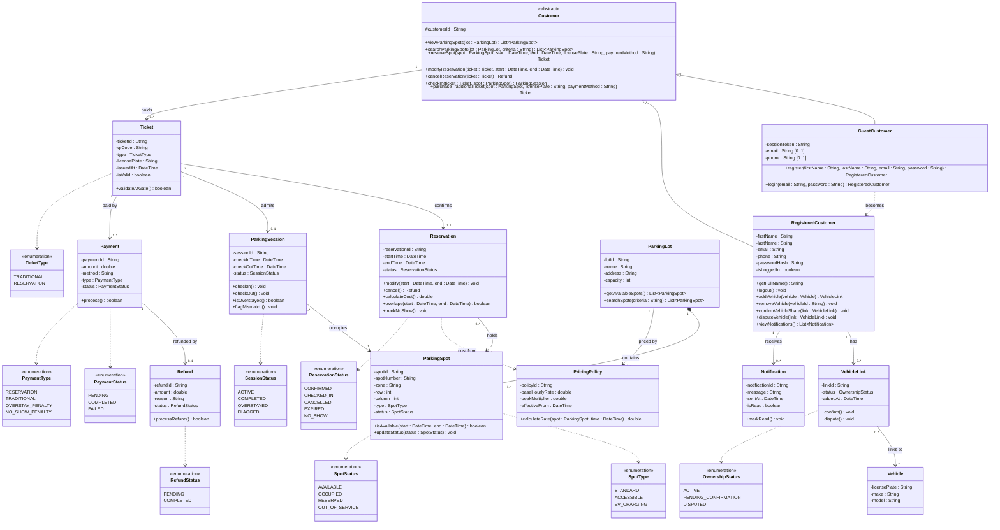
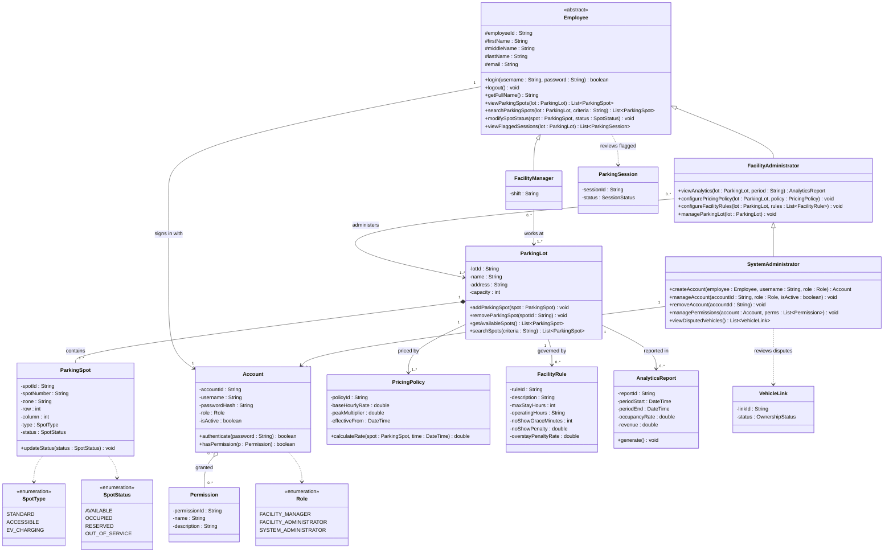

# Rush Hour Parking System - Class Diagram

## 1. Customer side (UC-01 to UC-10)

## 2. Employee side (UC-02E, UC-03 to UC-05, UC-11 to UC-17)

## 3. Combined

```mermaid
classDiagram
direction TB

%% ===== Customer side =====
class Customer {
  <<abstract>>
  #customerId : String
  +viewParkingSpots(lot : ParkingLot) List~ParkingSpot~
  +searchParkingSpots(lot : ParkingLot, criteria : String) List~ParkingSpot~
  +reserveSpot(spot : ParkingSpot, start : DateTime, end : DateTime, licensePlate : String, paymentMethod : String) Ticket
  +modifyReservation(ticket : Ticket, start : DateTime, end : DateTime) void
  +cancelReservation(ticket : Ticket) Refund
  +checkIn(ticket : Ticket, spot : ParkingSpot) ParkingSession
  +purchaseTraditionalTicket(spot : ParkingSpot, licensePlate : String, paymentMethod : String) Ticket
}

class GuestCustomer {
  -sessionToken : String
  -email : String [0..1]
  -phone : String [0..1]
  +register(firstName : String, lastName : String, email : String, password : String) RegisteredCustomer
  +login(email : String, password : String) RegisteredCustomer
}

class RegisteredCustomer {
  -firstName : String
  -lastName : String
  -email : String
  -phone : String
  -passwordHash : String
  -isLoggedIn : boolean
  +getFullName() String
  +logout() void
  +addVehicle(vehicle : Vehicle) VehicleLink
  +removeVehicle(vehicleId : String) void
  +confirmVehicleShare(link : VehicleLink) void
  +disputeVehicle(link : VehicleLink) void
  +viewNotifications() List~Notification~
}

class Vehicle {
  -licensePlate : String
  -make : String
  -model : String
}

class VehicleLink {
  -linkId : String
  -status : OwnershipStatus
  -addedAt : DateTime
  +confirm() void
  +dispute() void
}

class Notification {
  -notificationId : String
  -message : String
  -sentAt : DateTime
  -isRead : boolean
  +markRead() void
}

class Ticket {
  -ticketId : String
  -qrCode : String
  -type : TicketType
  -licensePlate : String
  -issuedAt : DateTime
  -isValid : boolean
  +validateAtGate() boolean
}

%% rule: the same license plate cannot hold two reservations that overlap in time
class Reservation {
  -reservationId : String
  -startTime : DateTime
  -endTime : DateTime
  -status : ReservationStatus
  +modify(start : DateTime, end : DateTime) void
  +cancel() Refund
  +calculateCost() double
  +overlaps(start : DateTime, end : DateTime) boolean
  +markNoShow() void
}

class ParkingSession {
  -sessionId : String
  -checkInTime : DateTime
  -checkOutTime : DateTime
  -status : SessionStatus
  +checkIn() void
  +checkOut() void
  +isOverstayed() boolean
  +flagMismatch() void
}

class Payment {
  -paymentId : String
  -amount : double
  -method : String
  -type : PaymentType
  -status : PaymentStatus
  +process() boolean
}

class Refund {
  -refundId : String
  -amount : double
  -reason : String
  -status : RefundStatus
  +processRefund() boolean
}

%% ===== Employee side =====
class Employee {
  <<abstract>>
  #employeeId : String
  #firstName : String
  #middleName : String
  #lastName : String
  #email : String
  +login(username : String, password : String) boolean
  +logout() void
  +getFullName() String
  +viewParkingSpots(lot : ParkingLot) List~ParkingSpot~
  +searchParkingSpots(lot : ParkingLot, criteria : String) List~ParkingSpot~
  +modifySpotStatus(spot : ParkingSpot, status : SpotStatus) void
  +viewFlaggedSessions(lot : ParkingLot) List~ParkingSession~
}

class FacilityManager {
  -shift : String
}

class FacilityAdministrator {
  +viewAnalytics(lot : ParkingLot, period : String) AnalyticsReport
  +configurePricingPolicy(lot : ParkingLot, policy : PricingPolicy) void
  +configureFacilityRules(lot : ParkingLot, rules : List~FacilityRule~) void
  +manageParkingLot(lot : ParkingLot) void
}

class SystemAdministrator {
  +createAccount(employee : Employee, username : String, role : Role) Account
  +manageAccount(accountId : String, role : Role, isActive : boolean) void
  +removeAccount(accountId : String) void
  +managePermissions(account : Account, perms : List~Permission~) void
  +viewDisputedVehicles() List~VehicleLink~
}

class Account {
  -accountId : String
  -username : String
  -passwordHash : String
  -role : Role
  -isActive : boolean
  +authenticate(password : String) boolean
  +hasPermission(p : Permission) boolean
}

class Permission {
  -permissionId : String
  -name : String
  -description : String
}

class FacilityRule {
  -ruleId : String
  -description : String
  -maxStayHours : int
  -operatingHours : String
  -noShowGraceMinutes : int
  -noShowPenalty : double
  -overstayPenaltyRate : double
}

class AnalyticsReport {
  -reportId : String
  -periodStart : DateTime
  -periodEnd : DateTime
  -occupancyRate : double
  -revenue : double
  +generate() void
}

%% ===== Shared classes =====
class ParkingLot {
  -lotId : String
  -name : String
  -address : String
  -capacity : int
  +addParkingSpot(spot : ParkingSpot) void
  +removeParkingSpot(spotId : String) void
  +getAvailableSpots() List~ParkingSpot~
  +searchSpots(criteria : String) List~ParkingSpot~
}

class ParkingSpot {
  -spotId : String
  -spotNumber : String
  -zone : String
  -row : int
  -column : int
  -type : SpotType
  -status : SpotStatus
  +isAvailable(start : DateTime, end : DateTime) boolean
  +updateStatus(status : SpotStatus) void
}

class PricingPolicy {
  -policyId : String
  -baseHourlyRate : double
  -peakMultiplier : double
  -effectiveFrom : DateTime
  +calculateRate(spot : ParkingSpot, time : DateTime) double
}

%% ===== Enumerations =====
class TicketType {
  <<enumeration>>
  TRADITIONAL
  RESERVATION
}
class ReservationStatus {
  <<enumeration>>
  CONFIRMED
  CHECKED_IN
  CANCELLED
  EXPIRED
  NO_SHOW
}
class PaymentStatus {
  <<enumeration>>
  PENDING
  COMPLETED
  FAILED
}
class RefundStatus {
  <<enumeration>>
  PENDING
  COMPLETED
}
class PaymentType {
  <<enumeration>>
  RESERVATION
  TRADITIONAL
  OVERSTAY_PENALTY
  NO_SHOW_PENALTY
}
class SessionStatus {
  <<enumeration>>
  ACTIVE
  COMPLETED
  OVERSTAYED
  FLAGGED
}
class OwnershipStatus {
  <<enumeration>>
  ACTIVE
  PENDING_CONFIRMATION
  DISPUTED
}
class SpotType {
  <<enumeration>>
  STANDARD
  ACCESSIBLE
  EV_CHARGING
}
class SpotStatus {
  <<enumeration>>
  AVAILABLE
  OCCUPIED
  RESERVED
  OUT_OF_SERVICE
}
class Role {
  <<enumeration>>
  FACILITY_MANAGER
  FACILITY_ADMINISTRATOR
  SYSTEM_ADMINISTRATOR
}

%% ===== Customer relationships =====
Customer <|-- GuestCustomer
Customer <|-- RegisteredCustomer
GuestCustomer ..> RegisteredCustomer : becomes
RegisteredCustomer "1" --> "0..*" VehicleLink : has
VehicleLink "0..*" --> "1" Vehicle : links to
RegisteredCustomer "1" --> "0..*" Notification : receives
Customer "1" --> "0..*" Ticket : holds
Ticket "1" --> "0..1" Reservation : confirms
Ticket "1" --> "0..1" ParkingSession : admits
Ticket "1" --> "1..*" Payment : paid by
Payment "1" --> "0..1" Refund : refunded by
Reservation "0..*" --> "1" ParkingSpot : holds
ParkingSession "0..*" --> "1" ParkingSpot : occupies
Reservation ..> PricingPolicy : cost from

%% ===== Employee relationships =====
Employee <|-- FacilityManager
Employee <|-- FacilityAdministrator
FacilityAdministrator <|-- SystemAdministrator
Employee "1" --> "1" Account : signs in with
Account "0..*" o-- "0..*" Permission : granted
SystemAdministrator "1" --> "0..*" Account : manages
FacilityAdministrator "0..*" --> "1..*" ParkingLot : administers
FacilityManager "0..*" --> "1..*" ParkingLot : works at
SystemAdministrator ..> VehicleLink : reviews disputes
Employee ..> ParkingSession : reviews flagged

%% ===== Shared relationships =====
ParkingLot "1" *-- "1..*" ParkingSpot : contains
ParkingLot "1" --> "1..*" PricingPolicy : priced by
ParkingLot "1" --> "0..*" FacilityRule : governed by
ParkingLot "1" --> "0..*" AnalyticsReport : reported in

%% ===== Enumeration usage =====
Ticket ..> TicketType
Reservation ..> ReservationStatus
Payment ..> PaymentStatus
Refund ..> RefundStatus
Payment ..> PaymentType
ParkingSession ..> SessionStatus
VehicleLink ..> OwnershipStatus
ParkingSpot ..> SpotType
ParkingSpot ..> SpotStatus
Account ..> Role
```

## GUI note (UC-04 View Parking Spot)

The simplified lot view is drawn from the same `List<ParkingSpot>` that `viewParkingSpots()` returns. Each spot is placed using `zone`, `row`, and `column`, and colored by `status`:

| Color | `SpotStatus` |
|---|---|
| Green | AVAILABLE |
| Yellow | RESERVED |
| Red | OCCUPIED |
| Grey | OUT_OF_SERVICE |

The color mapping is a GUI concern, so it is not in the class diagram.

## Use case coverage

| Use case | Where it lives |
|---|---|
| UC-01 Register | `GuestCustomer.register()` |
| UC-02 Login / UC-03 Logout (customer) | `GuestCustomer.login()`, `RegisteredCustomer.logout()` |
| UC-02E Employee Login / UC-03 Logout | `Employee.login()`, `Employee.logout()` |
| UC-04 View / UC-05 Search Parking Spot | `Customer` and `Employee` (`viewParkingSpots`, `searchParkingSpots`) |
| UC-06 Reserve | `Customer.reserveSpot()` |
| UC-07 Modify Reservation | `Customer.modifyReservation()` |
| UC-08 Cancel & Refund | `Customer.cancelReservation()` returns `Refund` |
| UC-09 Check-in | `Customer.checkIn(ticket, spot)` (QR ticket validated by `Ticket.validateAtGate()`) |
| UC-10 Purchase Traditional Ticket | `Customer.purchaseTraditionalTicket()` |
| UC-11 Modify Spot Status | `Employee.modifySpotStatus()` |
| UC-12 View Analytics | `FacilityAdministrator.viewAnalytics()` |
| UC-13 Configure pricing and policies | `FacilityAdministrator.configurePricingPolicy()`, `configureFacilityRules()` |
| UC-14 Manage Parking Lot | `FacilityAdministrator.manageParkingLot()` |
| UC-15 Create / UC-16 Manage / UC-17 Remove Account | `SystemAdministrator.createAccount()`, `manageAccount()`, `removeAccount()` |

## Assumption

| Assumption / rule | Model |
|---|---|
| Many users, same vehicle | `VehicleLink` (status `OwnershipStatus`) between `RegisteredCustomer` and `Vehicle`, many-to-many; `Notification` to every linked account; confirm or dispute; disputes shown to `FacilityAdministrator.viewDisputedVehicles()`. Notifications are in-app only |
| No-show | `ReservationStatus.NO_SHOW`, `Reservation.markNoShow()`, `FacilityRule.noShowGraceMinutes` and `noShowPenalty` |
| Overstay | `ParkingSession.status` (`SessionStatus`), `isOverstayed()`, `FacilityRule.overstayPenaltyRate` |
| Simulated penalties | `Payment.type` (`PaymentType`); a ticket can have 1..* payments |
| Wrong or stolen spot | `checkIn(ticket, spot)`, `ParkingSession.flagMismatch()`, status `FLAGGED`, `Employee.viewFlaggedSessions()` |
| Trolls / double booking | `Reservation.overlaps()`: the same plate cannot hold overlapping reservations. No per-plate or per-user cap, troll are accepted as accepted risk and monitored by Admin |